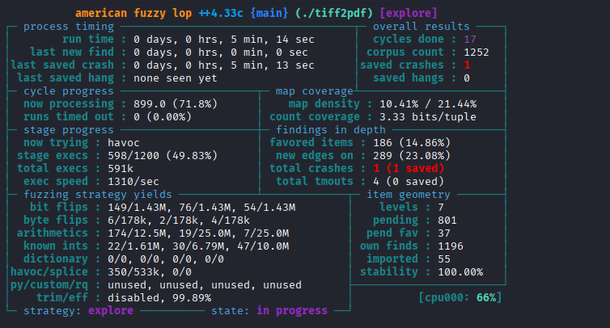
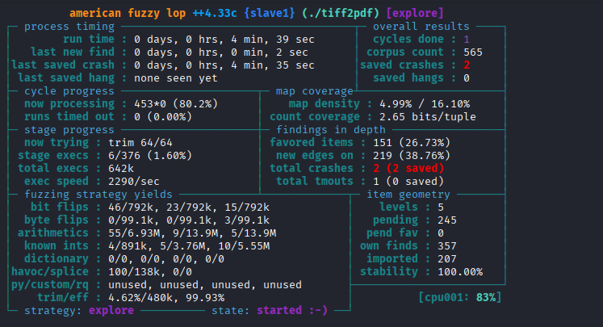

# Проверка устойчивости tiff2pdf к повреждённым TIFF-файлам

В команде из трёх человек я тестировал tiff2pdf из LibTIFF 4.0.3. Утилита читает TIFF-изображения, включая многостраничные, и формирует PDF. Нас интересовало, как конвертер ведёт себя на повреждённых входных данных: завершает ли обработку, аварийно ли останавливается или превышает отведённое время.

## Как наблюдали за тестированием

Мы собрали конвертер с инструментированием AFL++. При изменении входного файла фаззер получал обратную связь о выполнении программы и сохранял варианты, которые открывали новые пути в коде. Запустили два процесса с обменом находками. На панели каждого процесса отдельно отслеживали время работы, пополнение корпуса и сохранённые сбои.

На первом снимке показан основной процесс. Поле run time относится к моменту съёмки экрана, а saved crashes и saved hangs показывают промежуточные счётчики этого экземпляра.

На втором снимке в заголовке виден дополнительный экземпляр slave1. Его счётчики относятся к собственному ходу выполнения. Итоги всей работы мы свели отдельно после двух часов тестирования.

## Что зарегистрировали за два часа

| Наблюдение | Число срабатываний | Как интерпретировали |
|---|---:|---|
| Аварийное завершение | 39 | Конвертер остановился с ошибкой. Зафиксировали в том числе сигналы SIGSEGV и SIGABRT. |
| Превышение тайм-аута | 8 | Обработка файла заняла больше отведённого времени. Этого наблюдения недостаточно для вывода о бесконечном цикле. |

39 — число сохранённых срабатываний. Несколько файлов могли приводить к одному дефекту. Сам сигнал завершения показывает, что произошло с процессом, но оставляет открытым вопрос о причине.

## Как уточнили причину одного сбоя

Для анализа мы собрали отдельную версию tiff2pdf с AddressSanitizer. При проверке одного из аварийных случаев инструмент сообщил о выходе за границу буфера, выделенного в куче. Ниже приведена строка диагностики из отчёта.

Для этого случая удалось установить класс ошибки памяти. Для остальных в результатах оставили наблюдаемые симптомы — аварийное завершение или тайм-аут. Количество различных первопричин в этом прогоне мы не определяли.
